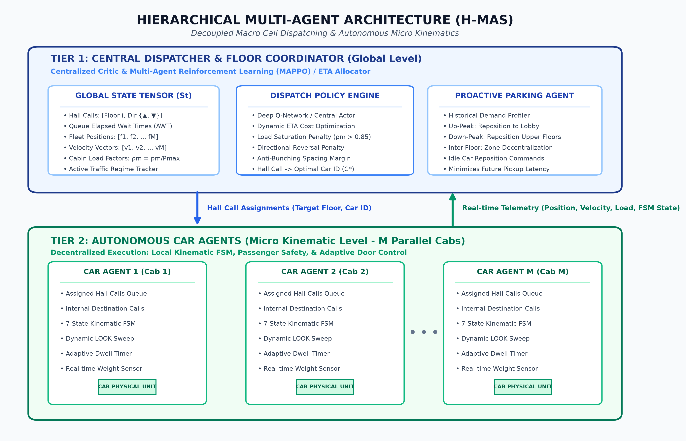
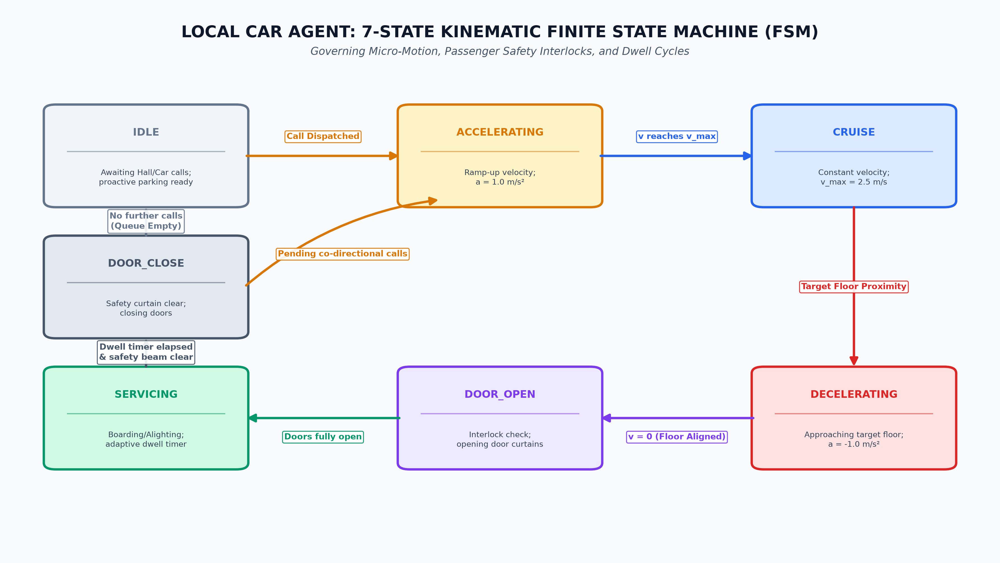
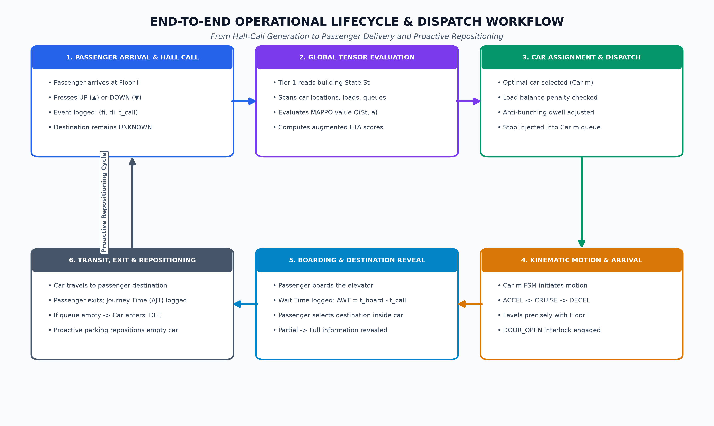

# PROJECT SYNOPSIS
## DEPARTMENT OF COMPUTER SCIENCE & ENGINEERING

---

### **PROJECT TITLE**
**Design and Simulation of a Hierarchical Multi-Agent AI System for Intelligent Group Elevator Dispatching in Multi-Zone High-Rise Buildings**

### **ACADEMIC YEAR & TEAM DETAILS**
* **Project Type:** Capstone / Major Project (B.Tech / M.Tech CSE)
* **Team Members:**
  1. **Divyanshu Yadav** – *Lead Researcher & System Architect*
  2. **Viraj & Co-developer** – *Core Algorithm & Simulation Engineering*
  3. **Vaibhav** – *Documentation, Technical Writing & Quality Assurance*
* **Faculty Supervisor / Guide:** *[To be assigned / Dr. / Prof.]*

---

## 1. INTRODUCTION & MOTIVATION

Vertical transportation in modern high-rise infrastructures represents both a critical operational bottleneck and a major component of total building energy consumption (accounting for 5% to 15% of building electricity). Conventional Elevator Group Control Systems (EGCS) installed in commercial buildings predominantly rely on deterministic, static heuristics—such as Nearest Car (ETA-based), Full Collective, and LOOK/SCAN directional sweeps. 

While computationally straightforward, these rule-based dispatchers suffer from fundamental limitations:
1. **Inability to Adapt to Non-Stationary Human Flows:** Static heuristics fail to handle non-stationary stochastic demand regimes, such as morning **Up-Peak** surges (bulk arrival at the ground floor heading to upper levels), evening **Down-Peak** departures (upper floors evacuating to the ground lobby), and lunchtime **Inter-Floor** traffic.
2. **Elevator Bunching:** Cars naturally drift into clusters where a leading car stops at every floor to collect passengers, while trailing cars run near-empty right behind it, doubling passenger wait times across remaining floors.
3. **Partial Information Bottleneck:** In standard two-button hall call systems ($\text{UP} / \text{DOWN}$), passenger destination floors remain strictly unknown until the passenger physically steps into the car.

To address these challenges, this project designs and simulates an intelligent **Hierarchical Multi-Agent System (H-MAS)** integrated with **Reinforcement Learning (RL)** and predictive idle car re-positioning. By decoupling macro-level group call allocation from micro-level car motion kinematics, the system dynamically minimizes Average Waiting Time (AWT), Average Journey Time (AJT), and energy consumption.

---

## 2. PROBLEM STATEMENT & MATHEMATICAL FORMULATION

Consider an $N$-floor high-rise building serviced by a bank of $M$ identical elevator cars ($C_1, C_2, \dots, C_M$), each with maximum rated capacity $P_{\max}$. The building operates under the standard industry **Two-Button Hall Call Interface** ($\text{UP}$ or $\text{DOWN}$).

```
                             [ BUILDING ELEVATOR BANK ]
 Floor N   [   ]          [   ]          [   ]          [   ]  (▲ / ▼ Hall Call)
    :        |              |              |              |
 Floor i   [Car 1]        [   ]          [Car 3]        [   ]  (Waiting Queue Q_i)
    :        |              |              |              |
 Ground    [   ]          [Car 2]        [   ]          [Car 4] (Lobby Surge)
```

The system is subjected to the following core challenges:
1. **Partial Observability:** When a hall call $h_k = (f_k, d_k, t_k^{\text{call}})$ is registered at floor $f_k \in \{1, \dots, N\}$ in direction $d_k \in \{\text{UP}, \text{DOWN}\}$ at timestamp $t_k^{\text{call}}$, the passenger’s destination floor $f_k^{\text{dest}}$ and passenger count are completely unknown until boarding.
2. **Multi-Objective Trade-Off:** The optimization goal is multi-objective and constrained:
   $$\min_{\pi} \left[ w_1 \cdot \text{AWT} + w_2 \cdot \text{AJT} + w_3 \cdot \text{StarvationPenalty} + w_4 \cdot \text{EnergyIndex} \right]$$
   where:
   * $\text{AWT} = \frac{1}{|P|} \sum_{p \in P} (t_p^{\text{board}} - t_p^{\text{call}})$ (Average Waiting Time)
   * $\text{AJT} = \frac{1}{|P|} \sum_{p \in P} (t_p^{\text{exit}} - t_p^{\text{board}})$ (Average Journey / In-Car Transit Time)
   * $\text{StarvationPenalty} = \max_{p \in P} (t_p^{\text{board}} - t_p^{\text{call}})$ (Anti-Starvation safeguard to prevent edge-floor neglect)
   * $\text{EnergyIndex} = \sum_{m=1}^M \left[ E_{\text{motion}} \cdot \Delta \text{Floors}_m + E_{\text{door}} \cdot N_{\text{stops}, m} + E_{\text{rev}} \cdot N_{\text{reversals}, m} \right]$

---

## 3. PROPOSED SYSTEM ARCHITECTURE (HIERARCHICAL MULTI-AGENT)

The system is engineered as a two-tier hierarchical multi-agent framework separating **Macro-Dispatching** from **Micro-Kinematic Execution**:


*Figure 1: Hierarchical Multi-Agent System (H-MAS) Architecture showing Tier-1 Central Dispatcher, Tier-2 Autonomous Car Agents, and Telemetric Inter-Tier Bus.*

```
+---------------------------------------------------------------------------------+
|                   TIER 1: GLOBAL DISPATCHER (Floor Coordinator)                 |
|  - Inputs: Hall Call Queue, Global State Tensor (Positions, Loads, Directions)  |
|  - Algorithms: Multi-Agent RL (MAPPO) / Multi-Factor ETA Cost Allocator         |
|  - Proactive Feature: Dynamic Idle-Car Parking Policy                           |
+---------------------------------------------------------------------------------+
                                       |
                Hall Call Assignments  |  Telemetric Feedback
                (Car ID per Call)      |  (Position, Velocity, Load, FSM State)
                                       v
+---------------------------------------------------------------------------------+
|                         TIER 2: LOCAL CAR AGENTS (Car 1 .. M)                   |
|  - Inputs: Assigned Hall Calls + Registered In-Car Destination Calls            |
|  - Engine: 7-State Kinematic Finite State Machine (FSM)                         |
|  - Motion Policy: Dynamic Directional SCAN/LOOK with Anti-Bunching Dwell Guard  |
+---------------------------------------------------------------------------------+
```

### **Tier 1: Global Dispatcher Agent (Macro Level)**
* **Role:** Acts as the centralized coordinator. It does not control motor throttles directly; instead, it decides **which car serves which hall call**.
* **Global State Representation ($S_t$):** Encodes:
  * Hall call matrix: $H \in \{0, 1\}^{N \times 2}$ (active $\text{UP} / \text{DOWN}$ requests and their elapsed wait times).
  * Fleet state: For each car $m \in \{1, \dots, M\}$: current floor $f_m \in [1, N]$, normalized velocity $v_m \in \{-1, 0, +1\}$, passenger load factor $\rho_m = p_m / P_{\max}$, and internal destination stop bitmask.
  * Time-of-day traffic phase indicator: Up-Peak, Down-Peak, or Inter-Floor.
* **Allocation Policy (RL / DQN & Heuristic Engine):**
  * Evaluates assignment value $Q(S_t, a)$, where action $a \in \{1, \dots, M\}$ maps the incoming hall call to car $m$.
  * Employs an augmented Estimated Time of Arrival (ETA) calculation with penalty offsets for car load saturation ($\rho_m > 0.85$) and directional reversal costs.
* **Proactive Parking Policy:** When a car becomes `IDLE`, Tier 1 evaluates floor traffic probability histograms and dispatches empty cars to predicted high-demand origins (e.g., ground floor during Up-Peak, mid-building during lunch hour) before calls arrive.

### **Tier 2: Car Agents (Micro Level – One per Elevator)**
* **Role:** Operates inside each elevator car, handling local passenger safety, door operations, and smooth kinematics.
* **Kinematic Finite State Machine (FSM):** Governs transitions between 7 discrete operational states:
  $$\text{IDLE} \longrightarrow \text{ACCELERATING} \longrightarrow \text{CRUISE} \longrightarrow \text{DECELERATING} \longrightarrow \text{DOOR\_OPEN} \longrightarrow \text{SERVICING} \longrightarrow \text{DOOR\_CLOSE}$$


*Figure 2: Autonomous Car Agent 7-State Kinematic Finite State Machine (FSM) and Motion Transition Graph.*
* **Call Execution & Anti-Bunching Policy:**
  * Merges assigned external hall calls with internal car calls (entered by passengers once onboard).
  * Executes an intelligent LOOK algorithm: continues in current direction while calls exist ahead; reverses only when no further co-directional requests remain.
  * Adjusts door dwell time dynamically based on real-time boarding count to avoid trailing another car too closely.

---

## 4. DETAILED OPERATIONAL WORKFLOW: HOW THE SYSTEM WORKS

The complete end-to-end operation follows an event-driven lifecycle:


*Figure 3: End-to-End Operational Workflow from Hall Call Registration to Kinematics, Boarding, Destination Selection, and Proactive Repositioning.*

```
[Passenger Arrives at Floor i]
             │
             ▼
[Presses UP / DOWN Hall Button] ────> [Hall Call Event Logged in Tier 1]
                                                     │
                                                     ▼
                                      [Tier 1 Evaluates Fleet State Tensor]
                                      - Car positions & directions
                                      - Passenger occupancy
                                      - Proximity & estimated arrival cost
                                                     │
                                                     ▼
                                      [Optimal Car Assigned (e.g., Car 2)]
                                                     │
                                                     ▼
                                      [Car 2 Local FSM Updates Stop Queue]
                                                     │
             ┌───────────────────────────────────────┴───────────────────────────────────────┐
             ▼                                                                               ▼
   [If Car 2 is IDLE]                                                              [If Car 2 is in Motion]
   Initiates ACCEL -> CRUISE                                                        Continues trajectory,
   towards target floor i                                                           schedules deceleration at floor i
             │                                                                               │
             └───────────────────────────────────────┬───────────────────────────────────────┘
                                                     ▼
                                      [Car 2 Arrives at Floor i: DOOR_OPEN]
                                                     │
                                                     ▼
                                      [Passenger Boards & Selects Destination Floor]
                                      - Wait Time (AWT) recorded for passenger
                                      - Internal Car Call registered in Car 2
                                                     │
                                                     ▼
                                      [DOOR_CLOSE -> Travel to Destination Floor]
                                                     │
                                                     ▼
                                      [Arrival at Destination: Passenger Exits]
                                      - Journey Time (AJT) logged
                                      - If no remaining calls -> Car enters IDLE
                                      - Proactive Parking Policy repositioning triggered
```

---

## 5. TRAFFIC PROFILE GENERATION & PASSENGER MODELING

To rigorously validate the system under real-world building conditions, the simulation implements non-stationary Poisson arrival processes $\mathcal{P}(\lambda(t))$ modeling three canonical traffic modes:

| Traffic Profile | Peak Period | Origin-Destination (O-D) Pattern | Primary Challenge for Group Control |
| :--- | :--- | :--- | :--- |
| **Up-Peak** | Morning Arrival (8:30 – 9:30 AM) | 80% Ground $\rightarrow$ Upper floors; 20% Inter-floor | Lobby congestion, long ground-floor wait queues, car overcrowding |
| **Down-Peak** | Evening Departure (5:00 – 6:30 PM) | 80% Upper floors $\rightarrow$ Ground; 20% Inter-floor | Full cars bypassing intermediate floors; severe passenger starvation |
| **Inter-Floor** | Lunch / Meetings (12:00 – 2:00 PM) | Uniformly distributed across all floor pairs $(i, j)$ | High directional reversals, elevator bunching, empty car wander |

---

## 6. SIMULATION ENGINE & 2D PYGAME VISUAL DASHBOARD

The project features a full-stack, standalone software implementation built without proprietary dependencies:

```
+--------------------------------------------------------------------------------------+
|                                PYGAME GRAPHICAL DASHBOARD                            |
|  [Shaft 1]       [Shaft 2]       [Shaft 3]       [Shaft 4]    │  TELEMETRY PANEL     |
|   Floor 15 [ ]    Floor 15 [ ]    Floor 15 [▲]    Floor 15 [ ] │  - Simulation Tick  |
|       :               :               :               :        │  - Active Passengers |
|   Floor 08 [▲]    Floor 08 [▼]    Floor 08 [ ]    Floor 08 [ ] │  - Avg Wait Time    |
|   Floor 04 [ ]    Floor 04 [ ]    Floor 04 [ ]    Floor 04 [▼] │  - Avg Journey Time |
|   Lobby    [■]    Lobby    [ ]    Lobby    [ ]    Lobby    [■] │  - Energy Consumption|
+--------------------------------------------------------------------------------------+
```

* **Simulation Backend (SimPy / Custom Tick Engine):** Implements physical kinematics including velocity curves ($v_{\max} = 2.5 \text{ m/s}$), acceleration ($a = 1.0 \text{ m/s}^2$), door cycle delays ($t_{\text{door}} = 3.0 \text{ s}$), and passenger transfer delays ($1.0 \text{ s/person}$).
* **Frontend Visualization (Pygame):**
  * Real-time 2D animated rendering of multi-car elevator shafts, floor levels, and cabin position indicators.
  * Live dynamic passenger queue representations on each floor with directional indicators ($\blacktriangle / \blacktriangledown$).
  * Real-time cabin load gauge (green $\rightarrow$ yellow $\rightarrow$ red) representing capacity saturation.
  * Live telemetry graph rendering real-time AWT, AJT, and energy efficiency indices.

---

## 7. BENCHMARKING & EXPERIMENTAL EVALUATION PLAN

The proposed Hierarchical Multi-Agent RL System will be quantitatively benchmarked against standard industry baselines across identical traffic seeds:
1. **Full Collective Algorithm:** Traditional baseline servicing all calls along the current direction before reversing.
2. **Nearest Car (Simple ETA):** Naive greedy allocation without load balancing or bunching prevention.
3. **Decoupled LOOK/SCAN Algorithm:** Standard modern heuristic baseline without predictive parking.

### **Target Performance Goals**
* **$20\% - 30\%$ reduction in Average Waiting Time (AWT)** during Up-Peak and Down-Peak surges.
* **$15\% - 25\%$ reduction in Average Journey Time (AJT)** through optimized stop consolidation.
* **Zero passenger starvation** ($\text{Max Wait Time} < 180\text{ seconds}$ under heavy load).
* **$15\%$ reduction in unnecessary floor traversals and reversals**, improving building electrical efficiency.

---

## 8. HARDWARE, SOFTWARE & IMPLEMENTATION STACK

* **Programming Language:** Python 3.10+
* **Deep Learning & Math:** PyTorch (DQN / Actor-Critic network implementation), NumPy, SciPy
* **Simulation Core:** Discrete-event execution framework (SimPy / Custom high-performance event loop)
* **Visualization & GUI:** Pygame (2D interactive graphics and real-time heads-up display)
* **Data Logging & Analysis:** Pandas, Matplotlib, Seaborn (for comparative trajectory and wait-time distribution curves)

---

## 9. WORK BREAKDOWN & TIMELINE

| Phase | Milestone / Key Deliverables | Duration | Responsibility |
| :--- | :--- | :--- | :--- |
| **Phase 1** | Mathematical modeling, kinematic specification, FSM design, and synopsis approval | Weeks 1 – 2 | Divyanshu, Viraj, Vaibhav |
| **Phase 2** | Discrete-event simulator engine, passenger traffic generator, and baseline algorithms (Collective, LOOK) | Weeks 3 – 5 | Viraj & Co-developer |
| **Phase 3** | Tier-1 RL Dispatcher (DQN/ETA), Tier-2 Car FSM integration, and proactive parking policy | Weeks 6 – 8 | Divyanshu & Viraj |
| **Phase 4** | Pygame 2D real-time visual dashboard, telemetry HUD, and parameter tuning controls | Weeks 9 – 10 | Viraj & Divyanshu |
| **Phase 5** | Rigorous benchmarking, ablation studies, statistical plots, and final capstone thesis documentation | Weeks 11 – 12 | Vaibhav & Divyanshu |

---

## 10. CONCLUSION & EXPECTED OUTCOMES

This project delivers a comprehensive, scientifically validated simulation of an intelligent Hierarchical Multi-Agent Group Elevator Control System. By combining high-level intelligent call dispatching with autonomous local car kinematics, the system overcomes the structural flaws of classical dispatching algorithms—preventing elevator bunching, mitigating peak-hour bottlenecks, and reducing building energy footprint. The resulting software artifacts include a production-grade discrete-event simulator, a trained multi-agent model, an interactive Pygame visualizer, and a comparative research report.
